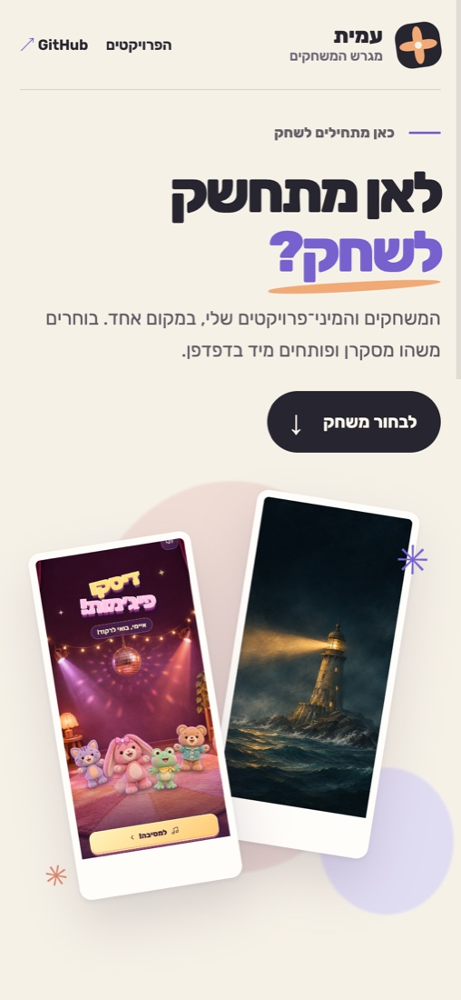
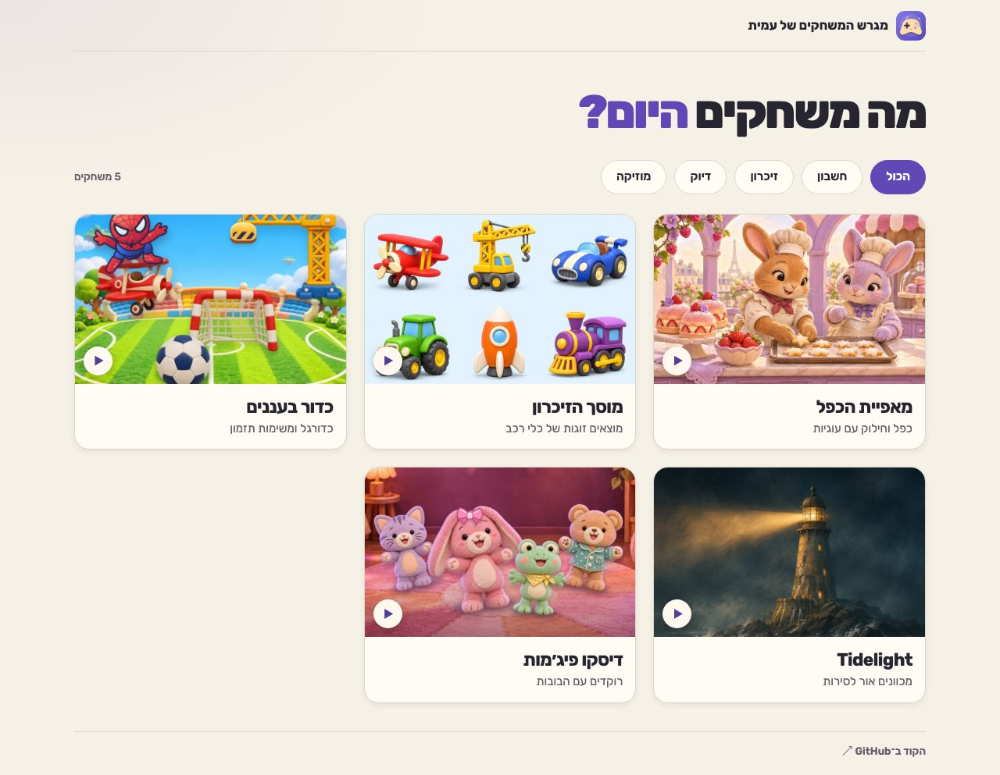

# מגרש המשחקים של עמית

שער כניסה למשחקי דפדפן ולמיני־פרויקטים, עם תצוגה מותאמת לטלפון ולמחשב. כל כרטיס מוביל לפרויקט שפורסם ב־GitHub Pages.

**האתר** — https://amitshe.github.io/

## הוספה למסך הבית

באייפון פותחים את האתר ב־Safari ובוחרים **שיתוף ← הוספה למסך הבית**. באנדרואיד פותחים אותו ב־Chrome ובוחרים בתפריט **התקנת אפליקציה** או **הוספה למסך הבית**. לשער הכניסה יש אייקון משלו.

## מה נמצא באתר

- [מאפיית הכפל](https://amitshe.github.io/multiplication-bakery/) — תרגול כפל וחילוק לפי לוח הכפל עד 10×10 עם מגשי עוגיות. [קוד מקור](https://github.com/AmitShe/multiplication-bakery).
- [מוסך הזיכרון](https://amitshe.github.io/memory-garage/) — משחק קלפים עם כלי רכב וזוג נוסף בכל שלב. [קוד מקור](https://github.com/AmitShe/memory-garage).
- [כדור בעננים](https://amitshe.github.io/cloud-kick/) — שלושה אתגרי כיוון ותזמון לגילאי 5–6 עם ספיידרמן, כדורגל, מטוס ומנוף. [קוד מקור](https://github.com/AmitShe/cloud-kick).
- [Tidelight](https://amitshe.github.io/tidelight/) — משחק מגע עם מגדלור וסירות.
- [דיסקו פיג׳מות](https://amitshe.github.io/pajama-disco/) — משחק ריקוד מוזיקלי שנוצר עבור איימי.
- [קוד המקור של Tidelight](https://github.com/AmitShe/tidelight) ו[קוד המקור של דיסקו פיג׳מות](https://github.com/AmitShe/pajama-disco) נמצאים בריפוזיטוריז נפרדים.

## צילומי מסך

<p align="center">
  
  
</p>

## הוספת פרויקט

כל משחק חדש מקבל ריפוזיטורי משלו ב־GitHub, עם `README.md` מלא שכולל הוראות וצילומי מסך, ואייקון ייחודי לקיצור במסך הבית. מפרסמים אותו ב־GitHub Pages ומוודאים שאפשר לשחק בו בטלפון בלי התחברות. הכללים המלאים למי שמתחזק את האתר נמצאים ב־`AGENTS.md`.

1. מוסיפים תמונת תצוגה של המשחק לתיקיית `assets/`.
2. משכפלים אחד מכרטיסי `project-card` בתוך `project-grid` בקובץ `index.html`.
3. מעדכנים בכרטיס את קישור המשחק החי, הכותרת, התיאור וטקסט התמונה.
4. מעדכנים את מספר הפרויקטים ב־`project-count` ואת רשימת המשחקים ב־README הזה.
5. דוחפים את השינוי לענף `main`, ומוודאים שהקישור פועל באתר לאחר פרסום GitHub Pages.

## הפעלה מקומית

אין שלב בנייה. מתוך תיקיית הפרויקט:

```sh
python3 -m http.server 8000
```

פותחים את http://localhost:8000/ בדפדפן.

## מבנה הפרויקט

- `index.html` מכיל את התוכן וקישורי הפרויקטים.
- `styles.css` מגדיר את הפריסה, הטיפוגרפיה והמצבים לטלפון ולמחשב.
- `assets/` מכילה תמונות תצוגה, סמל וגופנים. רישיון הגופן נמצא ב־`assets/rubik-license.txt`.
- `screenshots/` מכילה צילומי מסך לתיעוד.

האתר סטטי ומתפרסם משורש ענף `main` באמצעות GitHub Pages. הקובץ `.nojekyll` מבקש הגשה ישירה של הקבצים.
